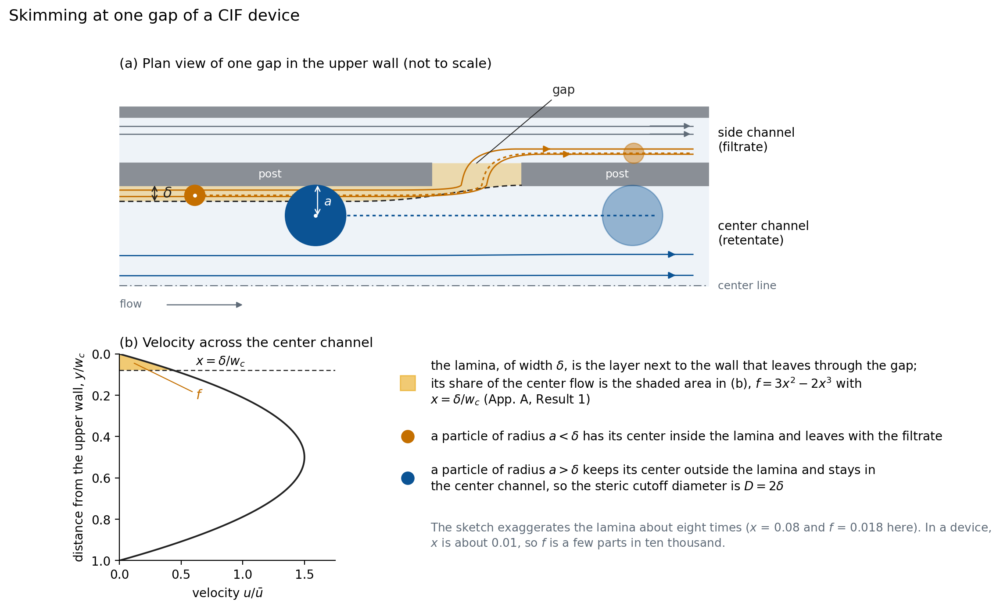

# opencif

opencif designs Controlled Incremental Filtration (CIF) devices, which are microfluidic chips that sort suspended
particles by size. From a size cutoff $D$ and a filtrate fraction $F$, together with a fabrication process and a
choice of parts, it plans the device, draws it as a DXF photomask, measures the drawing, solves the flow on it, and
audits the photomask file it wrote. Every build ends in a record that states, gap by gap, what the drawn mask does.

## How a CIF device sorts particles

A CIF device is a straight center channel whose two walls are rows of posts. The opening between two neighboring
posts is a 'gap', and beyond each row of posts runs a side channel. At every gap, a thin layer of fluid next to the
wall, the 'lamina', leaves the center channel and joins the side channel, while the rest of the fluid flows on.
Figure 1 shows one gap. A sphere cannot bring its center closer to the wall than its radius, so a particle whose
radius exceeds the lamina's width $\delta$ never has its center inside the lamina and stays in the center channel,
whereas a smaller particle can leave with the lamina. Thus, the lamina's width sets a cutoff diameter. The ideal
(steric) picture gives $D = 2\delta$, whereas the devices that Gifford et al. (2014) measured give $D = \kappa_g\delta$
with $\kappa_g = 4.9138$ (Appendix A, Result 5; `foundation/` holds the texts that opencif cites).



*Figure 1. Skimming at one gap. (a) The lamina (orange) leaves through the gap, bounded by the dashed dividing
streamline; a particle whose center lies inside the lamina leaves with it, and a larger one passes the gap. (b) The
velocity across the center channel is parabolic, so the lamina carries only the small fraction $f = 3x^2 - 2x^3$ of
the center flow, with $x = \delta/w_c$ (Appendix A, Result 1). The sketch exaggerates the lamina about eight times;
`tools/tutorial_figures.py` draws it.*

The fraction $f$ that each gap takes is a few parts in ten thousand, and the calibration of the cutoff law covers $f$
up to $5.76\times10^{-4}$ (the glossary's design cap). Each row of gaps takes $2f$ of the flow
that reaches it, so after $N$ rows the share of the inlet flow that has left through the side channels, the 'filtrate
fraction', is $F = 1 - (1 - 2f)^N$ for a constant $f$ when the side channels start sealed, the default (Appendix A, Results 8 and 10); a side channel that starts at the process floor delivers $F = 1 - P(N)/(1 + 2\sigma_0)$, with $P(N) = (1 - 2f)^N$ here and $\sigma_0$ its starting flow share (`foundation/Ladder_Array_Design_Spec_v5.md`, revision 5.1, §10; `docs/OPTIONS.md`, `start`).

## From two numbers to a device

The two targets are decoupled. The cutoff $D$ fixes the lamina and therefore $f$ at every row, and the filtrate
fraction $F$ then fixes only the number of rows $N$ (Appendix A, Results 8 and 13). The side channels' widths follow, row by
row, from the requirement that every gap take exactly its fraction, which is the closure of Appendix A, Result 10,
with the duct law of Result 14. opencif computes all of this from $(D, F)$ and draws it.

```python
import opencif
r = opencif.generate(4.0, 0.5, out='runs/my_first_device')   # D = 4 um and F = 0.5, every other part defaulted
print(r.verdict)          # PASS
print(r.physics_audit)    # PASS, the photomask file read back passed the physics audit
print(r.dxf)              # runs/my_first_device/cif_D4_F0p5.dxf
```

## Installation

opencif requires Python 3.11 or later. From the repository's folder, run

```
python3 -m venv .venv
. .venv/bin/activate                    # on Windows, .venv\Scripts\activate
pip install -r requirements-tested.txt  # the exact versions with which every record of this release was produced
pip install -e .                        # optional; makes opencif importable anywhere and adds the opencif command
python -m opencif --version             # opencif 1.0.0 (code 9e4eb55a0affeef3)
```

On Windows, run Python in its UTF-8 mode (`python -X utf8 -m opencif ...`, and the same for the tests): 1.0.0 writes
its summaries in the system's default text encoding, which there is not UTF-8 (`docs/LIMITATIONS.md` item 31). A
photomask written on Windows has CR LF line endings, so its sha256 differs from the release's while its geometry is
the same. Records written from a non-editable install carry no tests or lock stamp, so install with `pip install -e .`
when the records are to be compared with the release's.

With Python 3.11 and the versions in `requirements-tested.txt`, a build reproduces this release's photomasks byte for
byte, because every shipped design was rebuilt and compared (`docs/VALIDATION.md`). An independent reviewer
reproduced the tutorial of the preceding release candidate under Python 3.13 with the same package versions and
obtained the same printed numbers and the same photomask bytes. We do not promise identical output with other
versions.

## Use from the command line

```
python -m opencif generate 4 0.5 --out runs/demo                     # from the two targets (options in docs/OPTIONS.md)
python -m opencif build examples/gifford_physics_linear.yaml         # from a specification file
python -m opencif check examples/platelet_serpentine_chip.yaml       # plan and gate the design without drawing it
python -m opencif audit runs/demo                                    # audit a finished build again from its photomask
```

Each build writes into its folder the photomask `<name>.dxf` (layer CHANNELS is the fluid and layer ISLANDS the
posts), the record `<name>.json` (the design, every check, the physics audit, the design code's reports, and the code
stamp), a summary `<name>_summary.md`, three figures (`_layout.png`, `_zooms.png`, and `_physics.png`), the result of
the design-rule check (DRC), and the arrays from which the record was computed. The exit code is 0 for a pass, 2 for a
failure, 3 for a design outside the validity envelope, 4 for an incomplete build, 5 for a refused design, and 6 for an
error in the specification (`docs/ARCHITECTURE.md`).

## Where to start reading

The material is meant to be read in this order.

1. `notebooks/opencif_tutorial.ipynb` leads from a cutoff and a filtrate fraction to a photomask. It covers the
   kernels, the march, the closure, a first device, the validity envelope, the physics audit, new devices composed
   from parts, and the published devices. A first pass plans the published devices rather than building them, which
   saves about an hour, although its four other builds still take half an hour to an hour on two cores.
2. `opencif/teaching.py` follows the whole path for a straight ladder in fewer than 300 lines, each step named after the
   result of Appendix A that it uses, from the design to the photomask and back, reading the file without knowledge
   of the design. `tests/test_teaching.py` shows that its design is the full generator's, number for number.
3. `docs/ARCHITECTURE.md` follows one build of the full generator, step by step and module by module.
4. `docs/PHYSICS_AUDIT.md` describes the physics auditor's checks, where each comes from in the design code, the
   auditor's own ruler, and how the port was validated.

## What every build checks

Every build measures its own drawn polygon (every gap, side segment, head unit, U-turn, and outlet lead), solves the
flow network of the drawn device, and checks that the mask draws its design (Q1) and that every gap realizes $D$ and
the device realizes $F$ (Q2), at the nominal values of the junction terms; the verdict's model band gives the rows
that leave $D \pm 1\%$ when those terms take either end of their range (`docs/LIMITATIONS.md` item 8). It also runs the DRC and checks the topology, the clearances, the corner radii, the
aspect ratio, and the validity envelope. The physics auditor then reads the photomask file back and checks it. Its
checks are the design code's P1 to P10, ported; P0, which confirms that the file is the drawing; R0, in which the
auditor's own ruler re-measures the straight rows from the file and holds the generator's measurement to it; R6b, the
posts; and M14, the design code's Reynolds and Stokes gates on the drawn mask. The design code's mandatory reports
(pressure drop, $\eta F$, transfer bias, sensitivity map, operating regime, steric screen, and fabrication tolerance)
are recorded on every build.

## Validation of this release

`docs/VALIDATION.md` gives the evidence. In brief, 16 test suites pass, the kernels equal the design code's
bit for bit, the ported auditor returns the design code's own numbers on the design code's devices, and fourteen seeded
faults, which exercise every hard and envelope check except P2 (mass conservation) and P6b (the closed form for $F$),
are each caught by the check meant to catch them. Every shipped design was rebuilt with this release, giving 53
photomasks that are byte for byte the photomasks of the release candidate against which they were validated (RC8), and
every one was audited in the build and again from scratch. No device has been fabricated or measured with this release,
so the record's statements are statements of the one-dimensional network model on the drawn mask
(`docs/LIMITATIONS.md`).

## The published devices

`presets/` holds the devices of Gifford et al. (2014, Figs. 4, 5, and 6), Xia et al. (2016, RS-7), and Dinh et al.
(2024, V1) as specifications, which are built in reproduce mode with each paper's declared departures
(`docs/REPRODUCTIONS.md` and `docs/PRESET_PROVENANCE.md`). The papers' figures that the kits in `devices/` read are in
`notebooks/figures/` (`NOTICE.md`), and the kits trace the generator's photomasks onto them (`devices/README.md`).

## Repository layout

| folder | contents |
|---|---|
| `opencif/` | the package, with `physics/` (kernels, schedule, network, scenarios), `geometry/` (shapes, layout, DXF), `checks/` (measurement, DRC, the physics auditor and its ruler, the design code's reports), `figures/`, and the modules `spec`, `api`, `pipeline`, `build`, `compose`, and `teaching` |
| `reference/` | the design code that Appendix A names, `CIF_v2.py` v2.1.0, byte-frozen (the package does not import it, and the tests compare with it), and the glossary's numeric values that the tests pin |
| `tests/` | the acceptance suites (`docs/VALIDATION.md` lists each with its running time) |
| `examples/`, `presets/` | specifications for new designs, the design matrix, the decoupling set, and the published devices |
| `notebooks/` | the tutorial and the micrograph-traces notebook |
| `docs/` | the architecture, the physics audit, the validation, the design code's requirements, the options, the limitations, the alignment with Appendices A and B, the reproductions, the full reference (`REFERENCE.md`), the changelog, and the figures |
| `devices/` | the trace kits of the four published devices |
| `tools/` | scripts for figures, results tables, arrays, and device packages |
| `validation/` | this release's evidence, with every photomask's sha256 and audit, the plan regression, the suites' logs, and the scripts that made this tree from RC8 |
| `provenance/` | the scripts and records behind the values that the package takes as inputs and the documents cite (the review reports of the release candidates are not distributed; `provenance/README.md`) |
| `foundation/`, `reference_glossary/` | the texts that the code cites (Appendices A and B and the glossary, frozen on 2026-09-29, with the glossary's preamble, the design specification v5, and the errata list), and the preamble's copy that the tests read |

Appendix A (the step-by-step derivations, Results 1 to 15), Appendix B (the argument, claims C1 to C9), and the
glossary are the author's texts that the code cites, and they are in `foundation/` as LaTeX sources and PDFs, with
the design specification v5 and the errata list (`foundation/README.md`). The tests check their md5 sums and the
glossary's values against its preamble.

## Citation

Cite the release together with its code stamp (`CITATION.cff`), for example as follows.

> Routt, A. H. opencif 1.0.0 (code stamp 9e4eb55a0affeef3), a targets-to-photomask generator for Controlled
> Incremental Filtration devices. Zenodo, 2026. https://doi.org/10.5281/zenodo.23620100. Its kernels reproduce those of
> the design code CIF_v2.py v2.1.0 bit for bit, and the design code's physics auditor, ported, is run on every
> photomask that it writes.

The release is archived on Zenodo under the DOI 10.5281/zenodo.23620100 and kept at
https://github.com/Austin-Routt/opencif.

Every record names the code that produced it (`record.code.sha256`), so each photomask can be traced to the exact
code.

## License

opencif is released under the MIT License (`LICENSE`). The license covers the software, and it grants no rights under
any patent that covers the devices that the software designs. It does not cover `reference/CIF_v2.py`, the texts in
`foundation/` and `reference_glossary/`, or the publishers' figures in `notebooks/figures/`, which are distributed with
opencif under the terms stated in `NOTICE.md`. The repository is https://github.com/Austin-Routt/opencif.

## Data and figures

Everything in this repository was produced by opencif or written for it, apart from the design code and the frozen
texts that `NOTICE.md` names. The six published papers' figures in `notebooks/figures/` (Gifford 2014
and Dinh 2024, © the Royal Society of Chemistry, reproduced with its permission; Xia 2016, CC BY 4.0) are not covered
by the MIT License either. The trace suites read them with `OPENCIF_PAPER_RASTERS=notebooks/figures`, and the kits with
`--rasters notebooks/figures`.
